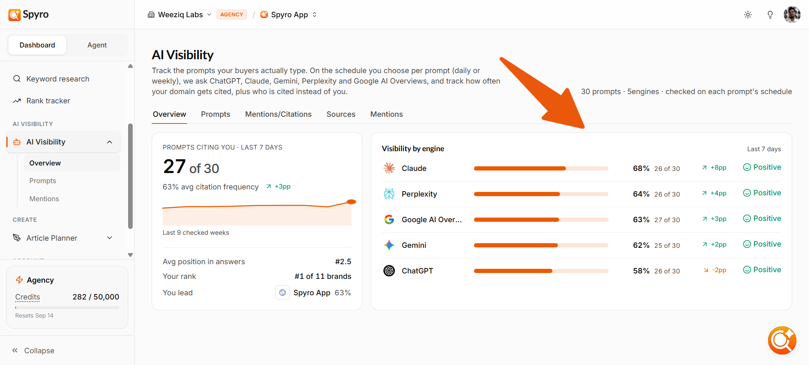

People don't just search Google anymore. They ask AI engines like **ChatGPT, Google AI Overviews, Gemini, Claude and Perplexity** for recommendations. **AI visibility** shows whether those engines mention _you_ when buyers ask, how you compare with your competitors, and which websites the engines rely on.

Here's how it works: Spyro AI asks the AI engines the questions your buyers ask (your [tracked prompts](/product/ai-visibility/prompts)) on a daily or weekly schedule. It records every answer: whether your brand is named, where it appears among the brands listed, the tone, and the sources cited.

## Why use it

<CardGroup cols={2}>
  <Card title="Are you recommended?" icon="robot">
    See whether AI engines name you when buyers ask for recommendations.
  </Card>
  <Card title="Who wins instead" icon="trophy">
    Find out which brands AI names most often, and where you rank among them.
  </Card>
  <Card title="Which sources matter" icon="link">
    See which websites and pages the engines cite, so you know where to be mentioned.
  </Card>
  <Card title="Trends over time" icon="arrow-trend-up">
    Notice when you start gaining (or losing) ground.
  </Card>
</CardGroup>

## Where to find it

The **AI visibility** group in the sidebar has five items: **Visibility**, **Prompts**, **AI answers**, **Citations** and **Sources**. The same pages also appear as tabs across the top of each AI visibility page, together with **Query fan-out**.

| Page | What it shows |
| --- | --- |
| **Visibility** (Overview tab) | Your overall AI visibility, how you rank, and how each engine treats you |
| **Prompts** | The buyer questions you track. See [Tracking prompts](/product/ai-visibility/prompts) |
| **AI answers** (Mentions tab) | Every answer the engines gave, word for word. See [AI mentions](/product/ai-visibility/mentions) |
| **Citations** (Mentions/Citations tab) | How often you're named and linked, by funnel stage and position |
| **Sources** | Every site and page the engines cited |
| **Query fan-out** | The web searches AI engines ran while answering your prompts |

## The overview

The **Visibility** page shows:

- **Your AI authority:** an overall level (from **Emerging** to **High AI Authority**), your **Share of Voice Rank** among the brands named, and your **Avg position when cited** (1 means you were named first).
- **Visibility by engine:** a card for each engine with your visibility on it, how many of your prompts it cited you for (for example, "26 of 30 cited"), how many answers named you, the change since the previous period, and the tone of those mentions.
- **Trends:** how often you're cited week by week, and how often answers link directly to your site.
- **Sentiment:** whether the answers that name you are positive, neutral or negative.

The first results appear after your prompts' first check. Weekly trend charts need at least two scheduled checks.

## How you compare with competitors

Every brand the engines name in their answers counts toward the comparison.

- **Share of voice** is your slice of all those brand mentions. If the engines name five brands and yours appears in a third of the answers, you have about a third of the share of voice.
- Because it's relative, your share can rise when you're named more often, or drop when a competitor surges ahead, even if your own mentions stayed the same.

To see the brands ranked side by side, look at the **Brands** card on your [dashboard](/product/dashboard): it lists the brands with the highest AI visibility, with your own brand marked **You**. The **Citations** page shows where brands land in answers (**Position distribution**).

## Citations

The **Citations** page focuses on how often you're named and linked:

- Answers that named your brand, and answers that linked one of your pages, week by week.
- **Decision journey:** your mention rate at each stage of the buyer's journey, across engines.
- **Position distribution:** where brands land in AI answers, so you can see whether you lead or trail the brands listed beside you.
- **Top cited sources** and **Highest leverage right now:** the sources that shape answers to your prompts.

Use the date filter (7, 30 or 90 days) to change the period.

## Sources

The **Sources** page is an index of every site and page the engines cited for your prompts. You can search it, group it by domain, and filter it by AI engine and by source type, and see what kinds of content get cited most and how each domain's citations are trending.

<Note>
  Full page addresses are collected from new checks onwards. Checks from before this feature show the cited domain only.
</Note>

## Query fan-out

When an AI engine answers a question, it often runs its own web searches first. **Query fan-out** shows those searches for each of your tracked prompts, so you can see what the engines actually looked for. ChatGPT, Claude and Perplexity share their searches; Gemini and Google AI Overviews don't.

## What to expect

- AI answers vary each time, so results are shown as rates across many checks, not a single yes or no.
- Each prompt is re-checked on its own schedule, weekly (Mondays) or daily, in your workspace's time zone.
- Starter tracks ChatGPT and Google AI Overviews; Pro and Agency track all 5 engines.
- If you haven't added any prompts yet, these pages are empty. Start by adding a few [tracking prompts](/product/ai-visibility/prompts).
- If your prompts are paused or your plan lapses, your earlier results stay visible.

## Tips

- Read this page with [Tracking prompts](/product/ai-visibility/prompts) to manage the questions, and [AI mentions](/product/ai-visibility/mentions) to read the actual answers.
- When a rival outranks you, find the prompts they win, then study those answers and the sources they cite.

## Related

<CardGroup cols={2}>
  <Card title="Tracking prompts" icon="list-check" href="/product/ai-visibility/prompts">
    Manage the buyer questions Spyro AI asks the AI engines.
  </Card>
  <Card title="AI mentions" icon="message" href="/product/ai-visibility/mentions">
    Read every answer and the exact snippet that names you.
  </Card>
  <Card title="Competitors" icon="users" href="/product/competitors">
    See where competitor information lives in Spyro AI.
  </Card>
  <Card title="AI writer" icon="pen-nib" href="/product/writer">
    Create content that earns citations in AI answers.
  </Card>
</CardGroup>
