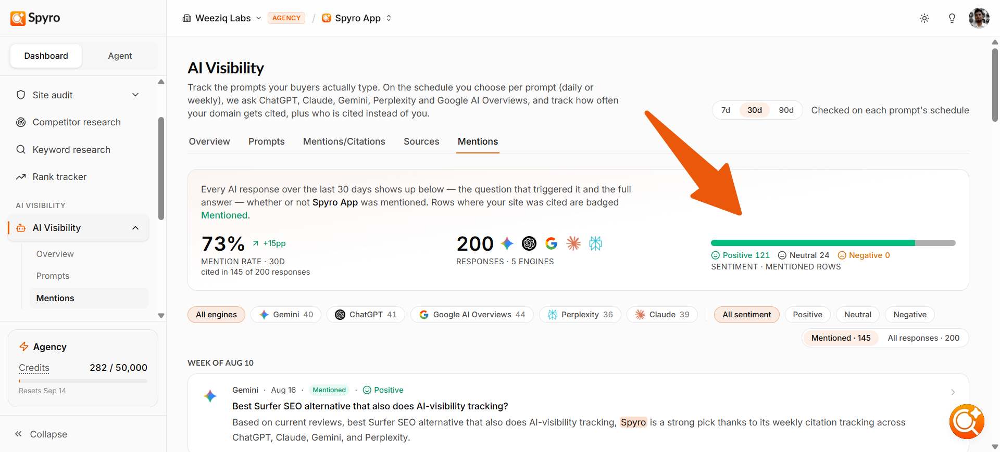

**AI mentions** shows what the AI engines actually _say_. It's a feed of every answer ChatGPT, Google AI Overviews, Gemini, Claude and Perplexity gave to your [tracking prompts](/product/ai-visibility/prompts), so instead of just numbers, you see the real words. In the sidebar it's called **AI answers**.

Where [AI visibility](/product/ai-visibility) tells you _how often_ you're mentioned and [Tracking prompts](/product/ai-visibility/prompts) manages _what gets asked_, this view shows you the _exact answers_, including the sentence where your brand appears.

## Why use it

<CardGroup cols={2}>
  <Card title="The real answers" icon="quote-left">
    See word for word what AI engines told buyers who asked.
  </Card>
  <Card title="The tone" icon="face-smile">
    See whether each mention of you was positive, neutral or negative.
  </Card>
  <Card title="Spot problems" icon="triangle-exclamation">
    Find answers that steer buyers away from you, the most important ones to fix.
  </Card>
  <Card title="Explain changes" icon="magnifying-glass">
    See the real answers behind any change in your AI visibility.
  </Card>
</CardGroup>

## What's in the feed

The feed covers the last **7**, **30** (the default) or **90 days**; switch with the buttons at the top. Answers are grouped by week, newest first. For each answer you see:

- **Which engine answered** and **when** the check ran.
- **The question** that prompted the answer.
- **Whether it mentioned you**: a **Mentioned** badge when it named your brand, or **Not mentioned**.
- **Your position** among the brands the answer names (1 means you were named first).
- **The tone** (positive, neutral or negative) for answers that mention you.
- **The snippet**: the exact excerpt, with your brand highlighted.

A summary at the top covers the same period: your mention rate and its trend, how many answers there were across how many engines, and the positive, neutral and negative split.

## How to use it

<Steps>
  <Step title="Open AI answers">
    Choose **AI answers** in the sidebar, under **AI visibility**.
  </Step>
  <Step title="Filter the feed">
    Filter by engine, by tone, and by whether the answer mentioned you (**Mentioned** or **All responses**).
  </Step>
  <Step title="Read the snippet">
    The highlighted snippet shows the exact sentence you appeared in, so you can judge _how_ you were described, not just whether you were named.
  </Step>
  <Step title="Watch the negatives">
    Filter to negative answers. They steer buyers away from you, and fixing them has the biggest payoff.
  </Step>
  <Step title="Open the full answer">
    Choose any answer to read the complete response and the sources the engine cited.
  </Step>
</Steps>

## What to expect

- The feed shows **every** answer in the period, mentioned or not, so you see the full picture.
- Tone is only labeled for answers that mention your brand. A very recent answer may briefly show as not yet labeled.
- If your prompts are paused or your plan lapses, the feed keeps showing your most recent answers.

## Tips

- This feed is the best place to understand _why_ your [share of voice](/product/ai-visibility) moved. A drop usually traces back to specific answers here: a rival the engine started recommending, or a question where it stopped naming you.
- When you find a negative or missed mention, note the question, then improve the content that should answer it.

## Related

<CardGroup cols={2}>
  <Card title="AI visibility" icon="robot" href="/product/ai-visibility">
    See your overall AI visibility and trends by engine.
  </Card>
  <Card title="Tracking prompts" icon="list-check" href="/product/ai-visibility/prompts">
    Manage the questions being asked.
  </Card>
  <Card title="AI writer" icon="pen-nib" href="/product/writer">
    Write content to improve missed or negative topics.
  </Card>
  <Card title="Competitors" icon="users" href="/product/competitors">
    See where competitor information lives in Spyro AI.
  </Card>
</CardGroup>
