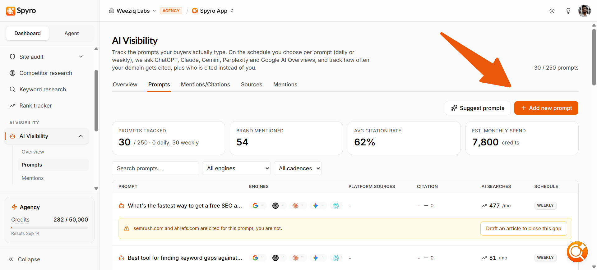

A **tracking prompt** is a real buyer question, the kind a customer would actually type into an AI engine, like _"best budget standing desk for a home office."_ On the schedule you choose, Spyro AI asks the AI engines your prompts and records how often the answers mention you.

Prompts are the starting point for [AI visibility](/product/ai-visibility): the questions you set here are what everything else measures. Ask the way a customer would, and **never include your own brand name**, because the point is to see whether AI recommends you on its own.

## Why use it

<CardGroup cols={2}>
  <Card title="Real buyer questions" icon="comments">
    Track the questions your customers ask AI before they buy.
  </Card>
  <Card title="You choose the engines" icon="robot">
    Decide which AI engines answer each question, and how often.
  </Card>
  <Card title="See who's cited" icon="users">
    Each prompt shows the competitor sites the engines cite.
  </Card>
  <Card title="Track your progress" icon="chart-line">
    Watch how often you're mentioned for each question over time.
  </Card>
</CardGroup>

## You start with suggestions

You don't begin with a blank page. During [setup](/product/onboarding), Spyro AI suggests buyer questions based on your website and competitors (10 on Starter, 20 on Pro and Agency), and you keep the ones you want.

For more ideas later, choose **Suggest prompts** on the **Prompts** page. Spyro AI suggests prompts worth tracking from your own search, competitor and AI data, and leaves out duplicates and prompts that name your brand. You can run suggestions up to 3 times a day.

## Add a prompt

<Steps>
  <Step title="Open Prompts">
    Choose **Prompts** in the sidebar, under **AI visibility**, then choose **Add new prompt**. (If you have no prompts yet, choose **Write my own**.)
  </Step>
  <Step title="Write the question">
    In **Prompt**, phrase it the way a real customer would, for example `best budget standing desk for a home office`.
  </Step>
  <Step title="Choose the engines">
    Tick the AI engines that should answer it. Starter can use **ChatGPT** and **Google AI Overviews**; Pro and Agency can use all 5.
  </Step>
  <Step title="Choose where and how often">
    Set the **Answer location** (the country the engines answer from) and the **Check frequency**:
    - **Weekly** runs every Monday at midnight, in your workspace's time zone.
    - **Daily** runs every day at midnight.
  </Step>
  <Step title="Check the cost and save">
    The form shows an estimate of the prompt's monthly credit cost. Choose **Start tracking**. The first check runs right away.
  </Step>
</Steps>

### What prompts cost

Each check costs **10 credits per engine** (**20** on Claude). For example, one prompt on all 5 engines costs 60 credits per check: about 260 credits a month if it's checked weekly, or 1,800 a month daily. See [Plans & billing](/product/billing-and-usage).

You can track up to **15** prompts per workspace on Starter, **50** on Pro and **250** on Agency.

## Manage your prompts

The **Prompts** page lists every prompt with its status, engines, last 4 checks, how often people ask AI assistants that question each month (**AI searches**), and its schedule. At the top you'll see how many prompts you track, how many mentioned your brand, your average citation rate and the estimated monthly credit spend. Search the list or filter it by engine and by schedule.

Open a prompt to manage it:

- **Pause** it with its toggle to stop checking it without losing its history. Turn it back on any time.
- **Change its schedule** between daily and weekly.
- **Delete** it with **Delete prompt** to remove it for good. This also erases its history, so pause it instead if you might want it back.

To change a prompt's wording, add a new prompt with the new wording and delete the old one.

## Read a prompt's results

Open any prompt to see:

- The **latest answer from each engine**.
- Your **average position in the answer** (1 means you were named first) and the **top competitor** for that question.
- **What AI is citing for this prompt**, and other sites **also cited** for it.
- **Recent mentions** of your brand for this prompt.

If competitors are cited and you aren't, choose **Draft an article**. Spyro AI studies the pages the AI engines cite and writes a brief for an article that can close the gap, which you can then **Add to calendar**. Building the brief is free.

<Note>
  Google doesn't show an AI Overview for every search. If it didn't show one on the latest check, the prompt says so: there was nothing to be cited in.
</Note>

## What to expect

- Results are shown as rates across checks, because AI answers vary each time.
- Trends need a few checks before they mean much.
- When many prompts are due at once, a prompt may show **Starts when a slot is free** before it runs.

## Tips

- Keep prompts in your customer's words. If it sounds like an SEO keyword, rewrite it as a natural question.
- Use the competitor sites on each prompt to spot rivals worth studying in [AI visibility](/product/ai-visibility).
- To read the exact wording of an answer, open [AI mentions](/product/ai-visibility/mentions).

## Related

<CardGroup cols={2}>
  <Card title="AI visibility" icon="robot" href="/product/ai-visibility">
    See your overall AI visibility and how you compare with competitors.
  </Card>
  <Card title="AI mentions" icon="message" href="/product/ai-visibility/mentions">
    Read every answer and the exact snippet that names you.
  </Card>
  <Card title="Competitors" icon="users" href="/product/competitors">
    See where competitor information lives in Spyro AI.
  </Card>
  <Card title="Plans & billing" icon="credit-card" href="/product/billing-and-usage">
    Credit costs and prompt limits per plan.
  </Card>
</CardGroup>
