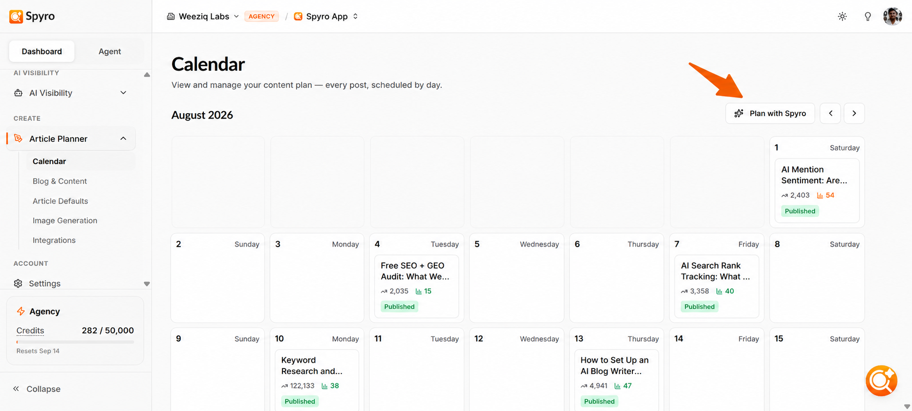

The **content calendar** is where you plan your blog. Instead of staring at a blank page, you get a month-by-month board of topic ideas, each placed on a day, so it's easy to see what's coming up and stay consistent.

Spyro AI does the research for you. It studies your website and your market, then suggests topics worth writing about. You stay in charge: you decide what to keep, when to publish it, and when to send it to the writer.

## Why use it

- **Never run out of ideas.** Spyro AI suggests low-competition topics based on your site and your competitors.
- **Stay consistent.** A clear monthly plan helps you publish regularly, which search engines and AI engines reward.
- **Save time.** Scheduled articles can be written and published for you automatically.

## How to use it

<Steps>
  <Step title="Open the calendar">
    Choose **Article Planner → Calendar** in the sidebar, under **Create**. After setup, Spyro AI usually builds a starter plan for you; a **Content plan progress** note shows while it's being researched.
  </Step>
  <Step title="Ask Spyro AI for more topics">
    Choose **Plan with Spyro** to open the planning panel. Ask in your own words, or pick a quick request such as **Fill my calendar** or **What to write next**. Spyro AI researches topics and suggests ideas. Each answer costs 10 credits.
  </Step>
  <Step title="Add ideas to your calendar">
    Suggested topics appear as candidates you can sort by **Easiest**, **Highest volume** or **Newest**. Topics marked **Easy win** are the easiest to rank for. Choose **Add to calendar** and pick a date.
  </Step>
  <Step title="Schedule or reschedule">
    To move an idea, drag it to another day, or use **Reschedule date**. To drop it, choose **Remove from calendar**.
  </Step>
  <Step title="Shape the article">
    Open an idea to edit its title, primary keyword, article brief and length (**Short**, **Standard** or **Deep guide**). You can also add custom instructions, things it must include or avoid, websites to link to, and a call to action. Choose **Save changes**.
  </Step>
  <Step title="Write it">
    Choose **Generate Article** to write it now, or leave it on the calendar and Spyro AI writes it on its scheduled day (see below). Each article costs 250 credits.
  </Step>
</Steps>

## Automatic writing and publishing

Every day at 06:00 (your workspace's time zone), Spyro AI writes the articles scheduled for that day. If you've connected your website and **Auto-publish** is on in [Article defaults](/product/article-settings), each finished article is then published for you.

<Note>
  Ideas whose date has already passed aren't written automatically. Drag them to today or a future date to schedule them again.
</Note>

Automatic writing needs an active subscription and counts toward your monthly article limit and credit pool, just like writing an article yourself.

## What to expect

The calendar shows one month at a time; use the arrows to move between months. While an article is being written, its card shows its progress (for example **Adding images…**) and updates by itself. Finished articles show as **Completed** and open in the [AI writer](/product/writer). If writing fails, choose **Retry**.

Each article costs **250 credits**, and your plan sets a monthly article limit: 8 on Starter, 30 on Pro and 120 on Agency. See [Plans & billing](/product/billing-and-usage).

## Tips

- Let Spyro AI seed the first batch of ideas, then use **Plan with Spyro** whenever you want to fill out the month.
- Keep a steady rhythm: a few well-spaced posts each week usually beats a big batch all at once.
- Set your article style and images first in [Content settings](/product/article-settings), so every article matches your brand.

## Related

<CardGroup cols={2}>
  <Card title="AI writer" icon="pen-nib" href="/product/writer">Edit and publish your articles.</Card>
  <Card title="AI agent" icon="robot" href="/product/spyro-ai-agent">Chat with the agent to research new ideas.</Card>
  <Card title="Content settings" icon="sliders" href="/product/article-settings">Set the style, images and auto-publish for your articles.</Card>
  <Card title="Plans & billing" icon="coins" href="/product/billing-and-usage">Understand article limits and credit costs.</Card>
</CardGroup>
