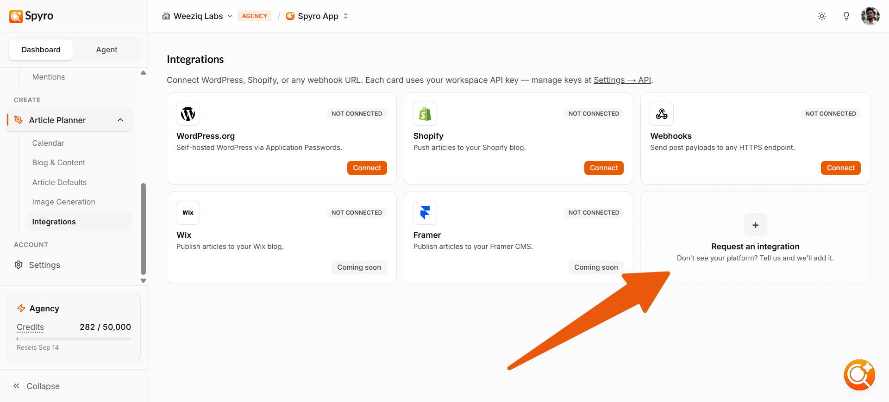

Integrations let Spyro AI work with the tools you already use. There are two kinds:

1. **Publishing integrations** send finished articles straight to your website.
2. **Search data connections** bring in your real Google and Bing performance.

You don't need any coding to set these up.

## Publish your articles

Open **Article Planner → CMS Integration** in the sidebar. (You can also get there from your profile menu, top right, under **Integrations**.) Each website (workspace) has its own integrations.

| Option | Status |
| --- | --- |
| **WordPress.org** (self-hosted WordPress) | Available |
| **Shopify** | Available |
| **Webhooks** (any system that accepts an HTTPS request) | Available |
| Wix, Framer, Webflow | Coming soon |

Don't see your platform? Use the **Request an integration** card to tell us.

<Note>
  Starter allows **2** connected integrations per workspace; Pro and Agency allow **5**.
</Note>

### Connect WordPress (self-hosted)

WordPress connects through the free **Spyro Autopilot** plugin and your workspace API key.

<Steps>
  <Step title="Create an API key">
    In Spyro AI, open **Settings → API keys** and create a key. Copy it: you'll paste it into WordPress. Only workspace admins can create keys.
  </Step>
  <Step title="Install the plugin">
    On the **CMS Integration** page, choose **Connect** on the **WordPress.org** card. Install and activate the **Spyro Autopilot** plugin from WordPress.org (or use **Download .zip** to upload it yourself).
  </Step>
  <Step title="Paste your key">
    In your WordPress admin, open **Settings → Spyro Autopilot** and paste your workspace API key.
  </Step>
  <Step title="Connect">
    Click **Connect to Spyro** in the plugin. Back in Spyro AI, the dialog shows **Plugin connected** once WordPress has registered.
  </Step>
</Steps>

<Note>
  The WordPress.org card still says "via Application Passwords". That text is out of date: the plugin and API key steps above are the current way to connect.
</Note>

### Connect Shopify

<Steps>
  <Step title="Enter your store address">
    On the **CMS Integration** page, choose **Connect** on the **Shopify** card and enter your store address, for example `my-store.myshopify.com`.
  </Step>
  <Step title="Approve the connection">
    Click **Continue with Shopify** and approve the request in Shopify. Spyro AI then publishes articles to your Shopify blog.
  </Step>
</Steps>

<Accordion title="Alternative: connect with a custom app token">
  1. In Shopify, go to **Settings → Apps and sales channels → Develop apps** and create an app.
  2. Under **Configure Admin API scopes**, enable `read_content`, `write_content` and `write_files`. Nothing else is needed.
  3. Install the app and copy its **Admin API access token** (it starts with `shpat_`).
  4. In Spyro AI, paste the token, click **Load blogs**, choose the blog under **Publish to blog**, and click **Connect**.
</Accordion>

### Connect a webhook

Use a webhook if your site runs on a system without a ready-made integration. Spyro AI sends each published article to the web address you give it. Ask whoever built your site for the right address.

<Steps>
  <Step title="Make sure you have an API key">
    Webhook deliveries are signed with your workspace API key, so create one first under **Settings → API keys** if you don't have one yet.
  </Step>
  <Step title="Add the address">
    Choose **Connect** on the **Webhooks** card, paste the address (it must start with `https://`), add an optional label, and click **Connect**.
  </Step>
</Steps>

Each delivery is a signed `post.published` event containing the full article: title, slug, HTML and Markdown, meta title and description, keywords, featured and in-article images, structured data and the publish date.

### Check that publishing works

Each integration card shows its status: **Connected**, **Failing**, **Paused** or **Not connected**. An integration turns **Failing** after 3 deliveries in a row fail.

Choose **Manage** on a connected integration to see its delivery history (time, event, status and duration), send a test with **Send test**, or **Disconnect** it.

<Tip>
  To publish automatically, turn on **Auto-publish** in [Article defaults](/product/article-settings). Otherwise, publish each article yourself from the [AI writer](/product/writer).
</Tip>

## Connect your search data

Connect **Google Search Console** and **Bing Webmaster Tools** on the **GSC & Bing** page to bring in your real clicks, impressions, positions and index data. Both connections are read-only. See [GSC & Bing](/product/search-console).

## API keys

An **API key** is a secret code that lets the Spyro Autopilot plugin and webhook deliveries connect to your workspace. Manage keys under **Settings → API keys**:

- You can keep up to **3** keys per workspace.
- Only workspace admins can create or delete keys.
- A key can register and manage this workspace's publishing integrations and read its published articles.

<Warning>
  Keep each key secret: anyone with it can act on this workspace. If a key leaks, delete it and create a new one, then update the plugin or webhook that used it.
</Warning>

## Use Spyro AI inside your AI apps

Want to ask Claude, ChatGPT, Gemini or Cursor about your rankings and audits? Connect the **Spyro AI MCP server** with one web address. See [MCP server overview](/product/mcp-overview).

## Related

<CardGroup cols={2}>
  <Card title="AI writer" icon="pen-nib" href="/product/writer">
    Publish drafted articles to your connected website.
  </Card>
  <Card title="Content settings" icon="sliders" href="/product/article-settings">
    Turn on auto-publish and publish-as-draft.
  </Card>
  <Card title="GSC & Bing" icon="google" href="/product/search-console">
    Connect Google Search Console and Bing Webmaster Tools.
  </Card>
  <Card title="Workspace settings" icon="gear" href="/product/settings">
    Manage API keys and other workspace settings.
  </Card>
</CardGroup>
