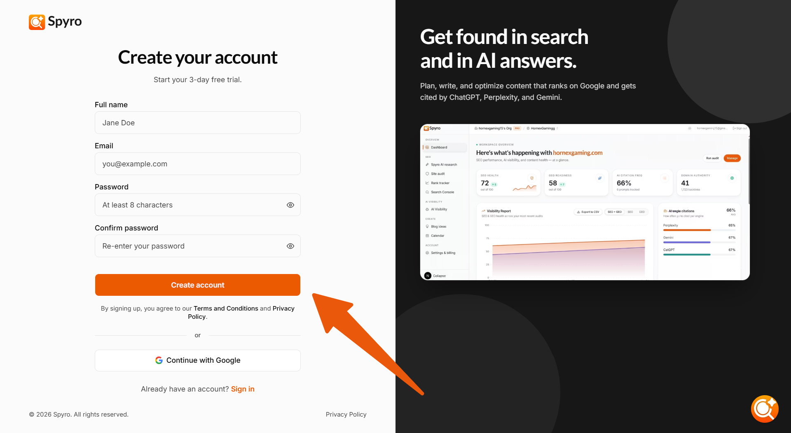

Setting up Spyro AI takes a few minutes. You create an account, choose a plan to start your free trial, and tell Spyro AI your website address. Spyro AI then reads your site to learn your brand, your audience and your competitors. When you're done, you land on your **dashboard**.

A **workspace** is one website you want to grow. Everything you do in Spyro AI (audits, rankings, content and settings) lives inside a workspace. Setup creates your first one inside your **organization**, which holds your plan, your credits and your team.

## 1. Create your account

<Steps>
  <Step title="Sign up">
    Open the sign-up page and enter your full name, email and a password (at least 8 characters), then choose **Create account**. Or choose **Continue with Google** to skip the password.
  </Step>
  <Step title="Confirm your email">
    Spyro AI emails you an **8-digit code**. Type it in to confirm your address; it submits as soon as all 8 digits are entered. If it doesn't arrive, choose **Resend code**. If you signed up with Google, you skip this step.
  </Step>
</Steps>

<Tip>
  Already have an account? Use the **Log in** page with your email and password, or **Continue with Google**. Forgot your password? Choose **Forgot password?** on the login page.
</Tip>

## 2. Choose a plan and start your trial

Next, you pick **Starter**, **Pro** or **Agency** and complete a secure checkout. Your **3-day free trial** starts here: you enter your card, but you aren't charged until the trial ends, and you can cancel any time before then.

If you've already had a free trial, billing starts right away instead. See [Plans & billing](/product/billing-and-usage) for what each plan includes and how the trial works.

## 3. Set up your first workspace

A short wizard walks you through setup. You can go back to any earlier step.

<Steps>
  <Step title="How you'll use Spyro">
    Choose **For my brand** (a single site) or **For my agency** (several client brands). Agencies also enter their agency name. You only see this step for your organization's first workspace.
  </Step>
  <Step title="Your website and market">
    Enter your website address (for example `example.com`), choose your **Target market** (country), and click **Analyze website**. Spyro AI reads your homepage and sitemap, picks up your brand colors and logo, and starts finding your competitors.
  </Step>
  <Step title="Your brand profile">
    Review what Spyro AI found: your brand name, brand colors, a short description of what your business does, your category, target market, language and **Target Audience Segments**. Edit anything that's off.
  </Step>
  <Step title="Your competitors">
    Review the competitors Spyro AI found. Add any it missed by entering their website, or remove ones that don't fit. If the search didn't work, choose **Retry**.
  </Step>
  <Step title="AI search prompts to track">
    Spyro AI suggests buyer questions to ask AI assistants (10 on Starter, 20 on Pro and Agency). Keep the ones that match how your customers search, remove the rest, or add your own. Then choose **Continue with N prompts**. Prompts are checked weekly by default.
  </Step>
  <Step title="How did you find us?">
    Tell us how you heard about Spyro AI, then choose **Finish setup**. You only see this step for your organization's first workspace.
  </Step>
</Steps>

<Note>
  Spyro AI only reads your **public** pages, the same ones any visitor can see. Everything it fills in is a draft you can edit, now or later in [Workspace settings](/product/settings).
</Note>

## 4. Your workspace is ready

After **Finish setup**, Spyro AI starts the heavy lifting in the background:

- Reading your pages and content
- Running your first SEO and Core Web Vitals audit
- Running your first AI readiness (GEO) audit
- Checking your domain authority (Ahrefs Domain Rating)
- Running your first AI search prompt checks

You can explore while this runs. Choose **Enter workspace dashboard** to continue.

### Done-For-You setup (Pro and Agency)

On Pro and Agency, the ready screen for your first workspace asks: *"Would you like us to set up your workspace for you and schedule 30 blog articles?"* Choose **Yes, I want** and our team will be in touch, or **No, I am fine** to carry on yourself.

## Landing in your workspace

Your dashboard shows a setup banner and a content-plan progress note while the background work runs. Cards fill in on their own as results come in, so there's no need to refresh.

<Tip>
  If you close the tab partway through setup, just come back. Spyro AI picks up where you left off.
</Tip>

## Related

<CardGroup cols={2}>
  <Card title="Your dashboard" icon="gauge" href="/product/dashboard">
    Explore the home base of your new workspace.
  </Card>
  <Card title="Run your first audit" icon="magnifying-glass" href="/product/audit">
    Check your site health and get actionable fixes.
  </Card>
  <Card title="Workspace settings" icon="sliders" href="/product/settings">
    Update your brand profile, audience and competitors.
  </Card>
  <Card title="Plans & billing" icon="credit-card" href="/product/billing-and-usage">
    Learn how the trial, credits and plans work.
  </Card>
</CardGroup>
