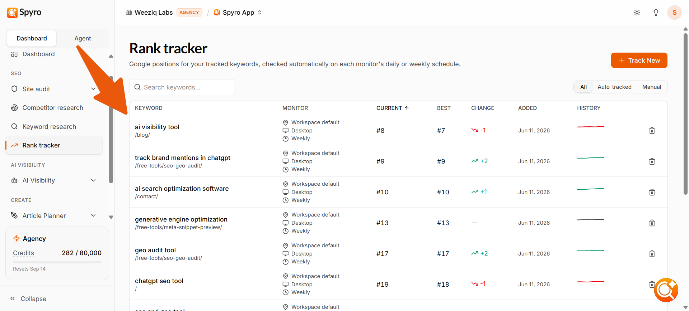

The **Rank tracker** shows where your pages land in Google for the keywords you care about, and charts how those positions move over time. You add the keywords you want to watch, and Spyro AI checks them for you on a daily or weekly schedule, so you always know whether you're climbing or slipping.

## Why use it

Rankings change all the time, and it's easy to miss it when a key page drops. The rank tracker keeps your important keywords in one place, shows which way each one moved, and charts your progress, so you can see what's working and react quickly when something slides.

## How to use it

<Steps>
  <Step title="Open the Rank tracker">
    Choose **Rank tracker** in the sidebar, under **Search (SEO)**.
  </Step>
  <Step title="Add a keyword">
    Choose **Track New**. Enter the keyword, and optionally a **location** (any country, region or city; if you leave it empty, your workspace's default is used), a **device** (desktop or mobile), and whether to check it **daily** or **weekly**. Then choose **Track keyword**.
  </Step>
  <Step title="Watch it over time">
    Spyro AI checks the new keyword right away, and its first position appears as soon as it's ready. Choose any keyword to see its full history chart.
  </Step>
</Steps>

<Tip>
  You can also track a keyword straight from [competitor research](/product/competitor-research) or a keyword's analysis page.
</Tip>

## What the table shows

Each keyword you track gets its own row, with:

- **Keyword** and the page of yours that ranks for it
- **Monitor**: the location, device and schedule (daily or weekly) it's checked on
- **Current**: where you sit in Google right now
- **Best**: the best position you've reached
- **Change**: how far it moved since the last check (green up, red down)
- **History**: a small chart of recent checks

You can search the list, sort it, and filter it to **All**, **Auto** (added by Spyro AI) or **Manual** (added by you).

The same keyword can be tracked more than once, for example in two countries or on desktop and mobile. Each combination is its own row.

## How often positions are checked

- **New keywords** are checked right away.
- **Weekly** keywords are re-checked every Monday at 02:00, in your workspace's time zone.
- **Daily** keywords are re-checked every day at 02:00.

Each check costs **2 credits** per keyword. A weekly keyword costs about 9 credits a month; a daily one about 60. See [Plans & billing](/product/billing-and-usage).

## Automatic keyword tracking

**Every time Spyro AI finishes writing an article, it automatically starts tracking the best keyword for it**, and it's smart about which one to pick.

Instead of just grabbing the obvious keyword, Spyro AI chooses the one the article is most likely to actually rank for, based on how competitive the keyword is and how strong your site is:

- On a **strong, established site**, it usually tracks the article's main keyword, because you can realistically rank for it.
- On a **newer site**, it tracks an easier, more specific keyword first. As your site grows stronger, the bigger keyword becomes worth tracking later.

The keyword it picks gets an **Auto** badge and is checked right away, so you see its starting position immediately.

## Good to know

- How many keywords you can track at once depends on your plan: **100** per workspace on Starter, **500** on Pro and **1,500** on Agency. Keywords Spyro AI adds automatically count too.
- **Deleting a keyword frees its slot right away**, so remove ones you no longer need.
- If you're at the limit, Spyro AI tells you when you try to add another, and skips automatic tracking until you free up space.

## Related

<CardGroup cols={2}>
  <Card title="GSC & Bing" icon="google" href="/product/search-console">
    Compare tracked rankings with your real Google and Bing data.
  </Card>
  <Card title="Competitor research" icon="users" href="/product/competitor-research">
    Find keywords your competitors rank for and you don't.
  </Card>
  <Card title="AI writer" icon="pen-nib" href="/product/writer">
    Create content to rank for your priority keywords.
  </Card>
  <Card title="Site audit" icon="magnifying-glass" href="/product/audit">
    Fix on-page and technical issues that affect your rankings.
  </Card>
</CardGroup>
