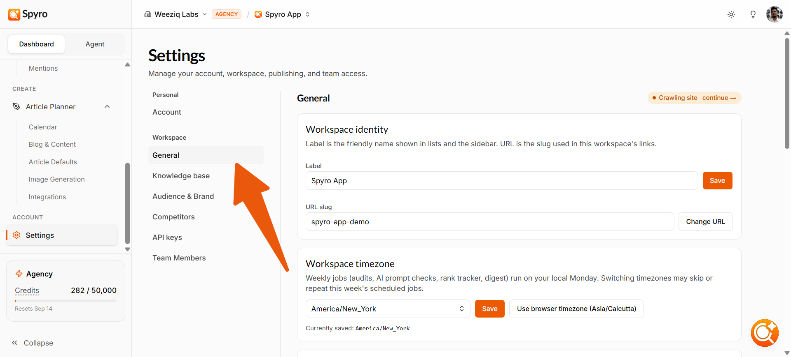

**Settings** is where you fine-tune one website (workspace) in Spyro AI: its name and time zone, who you sell to, the competitors you watch, and the pages Spyro AI has read.

Open it from **Settings** in the sidebar, under **Account**. The options sit in a menu on the left:

| Tab | What it's for |
| --- | --- |
| **Account** | Your email and your role in this workspace |
| **General** | Workspace name, URL, time zone, re-crawl, tone and brand profile, business profile |
| **Usage** | What credits this workspace has used this cycle |
| **Knowledge base** | The pages Spyro AI has read from your site |
| **Audience & Brand** | Who you write for |
| **Competitors** | The competitors you track |
| **API keys** | Keys for the WordPress plugin and webhooks |
| **Team Members** | Who can access this workspace (workspace admins only) |

## Why use it

A few minutes here pays off everywhere. When Spyro AI knows your time zone, your audience and your competitors, your scheduled checks run at the right time and your articles sound right for the people you're trying to reach.

## Account

A summary of _you_ in this workspace: the email you signed in with, and whether you're an **admin** or a **member** here.

To change your password, use **Forgot password?** on the login page. If you sign in with Google, manage your password in your Google account.

<Note>
  The Account tab currently says "Signed in with Google" for every account, including email-and-password accounts.
</Note>

## General

<Steps>
  <Step title="Workspace identity">
    Give the workspace a friendly **label**, so it's easy to spot when you switch between websites, and change its **URL slug** (the name used in this workspace's links) with **Change URL**.
  </Step>
  <Step title="Workspace timezone">
    Choose your time zone and choose **Save**, or use your browser's time zone. Your weekly audit, prompt checks, rank checks, automatic article writing and the weekly digest email all run on this local time.
  </Step>
  <Step title="Re-crawl this site">
    Choose **Re-crawl now** to have Spyro AI read your latest pages again, so your audits, tone and brand profile stay up to date.
  </Step>
  <Step title="Tone and brand profile">
    See the **tone profile** and **brand profile** (colors and style) Spyro AI learned from your site, and refresh either one after your site changes.
  </Step>
  <Step title="Business profile">
    Check your brand name, primary color, language and target market.
  </Step>
</Steps>

To remove the workspace and its data, use **Delete this workspace** at the bottom of the page. Spyro AI asks you to confirm first.

## Usage

**Usage & Credits** lists what this workspace spent credits on this cycle: each action, its category, how many times it ran, the credits each and the total. To see usage across all workspaces, open your organization's **Usage** page. See [Plans & billing](/product/billing-and-usage).

## Knowledge base

The list of every page Spyro AI found when it read your site, with each page's **SEO** and **GEO** scores. Choose a row to open that page's audit report. While a crawl runs, a progress note shows how far it has got.

### Add pages yourself

Spyro AI doesn't always find every page. Under **Add pages manually**, paste up to **10** page addresses, one per line, and choose **Add & crawl**. Spyro AI reads and scores each one right away, for free. Pages that aren't on your site, or that can't be read, are skipped and reported back to you.

<Note>
  If you haven't run an audit yet, this tab invites you to run your first [site audit](/product/audit), the scan that fills the page list.
</Note>

## Audience & Brand

Tell Spyro AI who you write for, and every article gets sharper:

- **Audience segments**: short tags for the people you sell to. Spyro AI fills these in from your site; edit, remove or add your own.
- **Business description**: a paragraph on what you do, who you serve, the problem you solve and what makes you different.

<Tip>
  This is the fastest way to improve the articles Spyro AI writes. The more honest detail you give, the more on-target the drafts feel.
</Tip>

## The competitors you track

The rival websites Spyro AI tracks for this workspace. Spyro AI found these during setup and discovers more as you research keywords. Add a competitor by entering its website, or remove ones that don't matter. Keep the list to the rivals that really count: they're suggested when you set up a [competitor research](/product/competitor-research) scan.

## API keys

An **API key** is a secret code that lets the Spyro Autopilot WordPress plugin and webhook deliveries connect to this workspace. **Most people only need one, for WordPress.**

<Steps>
  <Step title="Create a key">
    Choose **New key** and give it a name so you can tell your keys apart. You can keep up to 3 at a time.
  </Step>
  <Step title="Use it">
    Copy the key and paste it into the WordPress plugin. See [Integrations](/product/integrations).
  </Step>
  <Step title="Remove it">
    Choose **Delete key** to cut off access instantly.
  </Step>
</Steps>

<Warning>
  Treat each key like a password: anyone who has it can act on this workspace. Only workspace admins can create or delete keys.
</Warning>

## Team Members

Workspace admins can invite people to this workspace and remove them. See [Team members](/product/team-members).

## Related

<CardGroup cols={2}>
  <Card title="Team members" icon="users" href="/product/team-members">
    Invite teammates and manage roles.
  </Card>
  <Card title="Plans & billing" icon="credit-card" href="/product/billing-and-usage">
    Manage your plan and see credit usage.
  </Card>
  <Card title="Integrations" icon="plug" href="/product/integrations">
    Connect your website, Google Search Console and Bing.
  </Card>
  <Card title="Content settings" icon="pen-nib" href="/product/article-settings">
    Set your article style, images and auto-publish.
  </Card>
</CardGroup>
