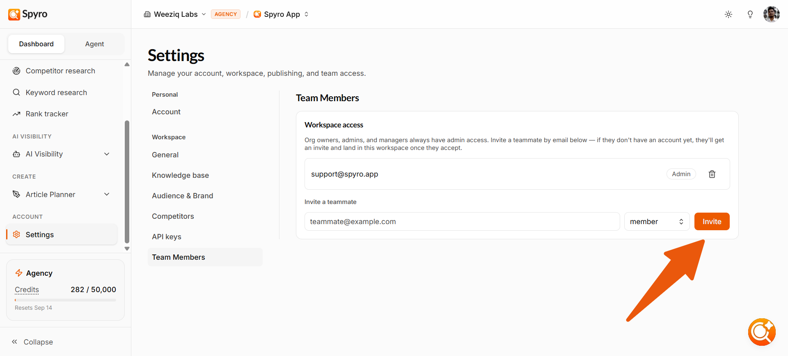

Spyro AI is built for teams, and team members are unlimited on every plan. You invite people by email, choose what they can do, and decide which of your websites (workspaces) they can work on.

## Roles in plain terms

Roles work at two levels: your **organization** (which holds your plan, credits and all your workspaces) and each **workspace**.

### Organization roles

| Role | What they can do |
| --- | --- |
| **Owner** | Everything, including switching plans, renaming the organization, transferring ownership and deleting the organization. There is one owner. |
| **Admin** | Full access to every workspace. Invites and removes organization members and changes their roles. Opens **Plan & billing** and **Manage billing**. |
| **Manager** | Full access to every workspace and can add new workspaces. Can't manage organization members or billing. |
| **Member** | Works only in the workspaces they've been added to. Can't add workspaces. |

### Workspace roles

Owners, admins and managers are automatically admins of every workspace. People with the **Member** organization role are added to individual workspaces as either:

- **Admin**: can change that workspace's settings, manage its team and API keys, and delete it.
- **Member**: can work in the workspace but can't change its settings or manage its team.

<Note>
  Only the owner can switch the plan. Owners and admins can open billing to update the card or download invoices. See [Plans & billing](/product/billing-and-usage).
</Note>

## Invite people to your organization

<Steps>
  <Step title="Open Members & invites">
    Open your profile menu (top right) at the organization level and choose **Members**, or go to your organization's settings and choose **Members & invites**.
  </Step>
  <Step title="Enter their email and pick a role">
    Under **Invite a teammate**, type their email and choose **Admin**, **Manager** or **Member**.
  </Step>
  <Step title="Send the invite">
    Spyro AI emails them a link and copies it for you. If the email can't be sent, use **Copy link** to share it yourself. Unaccepted invites are listed under **Pending invites**.
  </Step>
</Steps>

Only the owner and admins can invite people to the organization.

## Invite people to one workspace

<Steps>
  <Step title="Open the workspace's team">
    In the workspace, open **Settings → Team Members**. (Only workspace admins see this tab.)
  </Step>
  <Step title="Invite them">
    Enter their email, choose **Admin** or **Member**, and send the invite. If they don't have a Spyro AI account yet, they create one from the invite and land straight in this workspace.
  </Step>
</Steps>

<Tip>
  Invite someone to a **single workspace** when they only need to work on one website. Invite them to the **organization** as an admin or manager when they need every workspace.
</Tip>

## Accepting an invite

If you're the person being invited:

<Steps>
  <Step title="Open the link">
    Open the invite link in your email.
  </Step>
  <Step title="Sign in with the invited email">
    Use the **same email address the invite was sent to**. A forwarded link won't work for a different account. If you don't have a Spyro AI account yet, you'll create one first.
  </Step>
  <Step title="Start working">
    You land in the workspace you've been given access to.
  </Step>
</Steps>

<Warning>
  Invites expire after **14 days**. If a link has expired, ask for a fresh one.
</Warning>

## Changing roles and removing people

- **Change a role:** on **Members & invites**, choose a new role from the dropdown next to a teammate.
- **Remove someone from a workspace:** on that workspace's **Team Members** tab, remove them. They keep access to anything else they were given.
- **Remove someone from the organization:** remove them on **Members & invites** so they can't reach anything.
- **Cancel an invite:** revoke any invite that hasn't been accepted yet.
- **Transfer ownership:** the owner can hand the organization to another member, and becomes an admin.

<Note>
  The owner can't be removed. Only the owner and admins manage organization members.
</Note>

## Related

<CardGroup cols={2}>
  <Card title="Workspace settings" icon="sliders" href="/product/settings">
    Manage each website's settings and API keys.
  </Card>
  <Card title="Plans & billing" icon="credit-card" href="/product/billing-and-usage">
    Who can manage billing, and what each plan includes.
  </Card>
  <Card title="Set up your account" icon="rocket" href="/product/onboarding">
    How new accounts and workspaces are set up.
  </Card>
  <Card title="Questions and answers" icon="circle-question" href="/product/faq">
    Answers about plans, credits and access.
  </Card>
</CardGroup>
